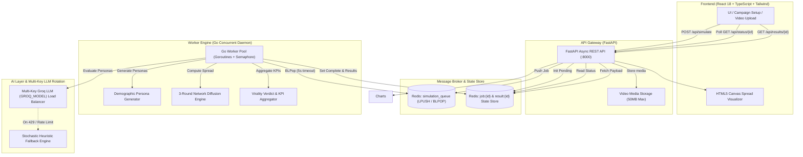

<div align="center">

# 🚀 Viralyst

### **Multi-Agent Synthetic Audience**

*Simulate social media virality, audience retention, and network cascade dynamics before publishing.*

[](https://golang.org/)
[](https://fastapi.tiangolo.com/)
[](https://reactjs.org/)
[](https://www.typescriptlang.org/)
[](https://tailwindcss.com/)
[](https://redis.io/)
[](https://groq.com/)
[](https://opensource.org/licenses/MIT)

[Features](#-key-features) • [Architecture](#-system-architecture) • [How It Works](#-simulation-mechanics--diffusion-dynamics) • [Quickstart](#-quickstart--installation) • [API Reference](#-api-reference) • [Author](#-author)

---

</div>

## 💡 Why Viralyst?

Traditional social media analytics are **strictly post-mortem**—you only discover whether a video hooks viewers, flops, or gets trapped in an echo chamber **after** you have burned your distribution, ad spend, and algorithmic goodwill.

**Viralyst flips the script:**

> **What if you could test your video hook against hundreds of AI personas with diverse demographics, realistic attention spans, and genuine social media skepticism before ever hitting "Publish"?**

Viralyst generates a synthetic audience of autonomous AI agents across diverse demographics, psychographics, and follower tiers. It simulates their split-second decisions (watch retention, like, comment, share, or skip) and models how content cascades through direct network sharing and algorithmic recommendation pushes across 3 diffusion rounds.

```
+------------------+      +-----------------------+      +---------------------------+
|  Your Video Hook | ---> | 100+ Synthetic Agents | ---> | Interactive Spread Graph  |
|  & Target Demo   |      |   (Groq LLM or offline)  |      | & Virality Verdict (0-100)|
+------------------+      +-----------------------+      +---------------------------+
```

---

## ✨ Key Features

### 🧠 1. Realistic Multi-Agent Persona Simulation
* **Psychological Realism:** Real users doomscroll with short attention spans and swipe past 75%–85% of content in under 3 seconds. Viralyst agents model authentic skepticism rather than sycophantic agreement.
* **19 Behavioral Archetypes:** Simulates *sharers, lurkers, skeptics, critics, influencers, early adopters, analytical thinkers, trend followers, mentors,* and more.
* **Granular Persona Identities:** Each agent has realistic global locations (US, UK, India, Germany, Brazil, Japan, etc.), culturally accurate names, matched genders, follower counts (50 to 10,000+), and multi-interest vectors.
* **LLM-Powered Reasoning:** When enabled, personas articulate **first-person rationale** explaining why they shared, commented, liked, or swiped past.

### 🌐 2. 3D Audience Globe & Spread Network
* **three.js Audience Globe:** Every simulated viewer is a node on a draggable 3D globe — your audience on one hemisphere, everyone else on the other — coloured by what they did, with share and recommendation arcs growing in round by round. Click a node to inspect the persona.
* **2D Network view:** The same cascade as a flat two-cohort graph on an HTML5 canvas.
* **Living backdrop:** A three.js crowd sphere behind the page speeds up while a simulation runs and recolours to the result's reaction mix. three.js is lazy-loaded in its own chunk, pauses when the tab is hidden, and honours `prefers-reduced-motion`.
* **Target vs. Out-of-Target Cohorts:** Visualizes in-target demographic engagement vs. algorithmic out-of-target crossover side-by-side.
* **3-Round Live Propagation:**
  * **Round 1 (Initial Hook):** Direct reaction from the initial seed audience based on content quality and hook strength.
  * **Round 2 (Direct Share Cascade):** Network expansion triggered by organic shares, weighted by follower reach.
  * **Round 3 (Algorithmic Push):** Recommendation system expansion into out-of-target cohorts driven by high engagement velocity and interest clustering.
* **Interactive Inspection Drawer:** Click any persona node to view their full profile, watch percentage, engagement decision, and LLM reasoning.
* **Replay & Scrub Bar:** Replay the multi-round cascade step-by-step or scrub back and forth.

### ⚡ 3. Multi-Provider, Multi-Key LLM Rotation (Groq + Gemini + Claude)
* **Concurrent Go Worker Pool:** High-throughput Go engine utilizing goroutines and semaphores for lightning-fast parallel persona evaluations.
* **Multi-Key Round-Robin:** Automatically discovers `GROQ_API_KEY`, `GROQ_API_KEY_1`...`GROQ_API_KEY_10` or comma-separated keys — and the same for `GEMINI_API_KEY…` — and rotates persona, topic and hook-rating calls across all of them, alternating providers, each with its own model. Video analysis stays on Groq (Whisper + vision).
* **Automatic 429 Rate-Limit Failover:** Seamlessly fails over to alternate keys upon hitting rate limits, backed by an intelligent heuristic fallback engine for uninterrupted simulations.

### 📊 4. Executive Virality Verdict & Deep Analytics
* **Virality Index (0–100):** 60% engagement quality (shares $3\times$, comments $2\times$, likes $1\times$) + 40% spread beyond the seed audience.
* **Core Predictive KPIs:** Total Reach, In/Out Demo Split %, Organic Share Rate %, Algorithm Score, and Non-Skip Engagement Rate %.
* **Qualitative Verdict Engine:** Categorizes outcomes into actionable verdicts:
  * ↔️ **Audience Mismatch:** The hook's topics don't match what the target audience cares about.
  * 🏆 **Viral Hit:** Strong in-demo spread with organic cross-demo viral breakout.
  * 🎯 **Niche Hit:** Deep engagement within target niche, limited broader crossover.
  * 🔁 **Echo Chamber:** High retention inside target group, fails algorithmic push.
  * ⚠️ **Weak Hook:** 60%+ of viewers who care about the topic still scrolled past in the first 3 seconds.
  * 📉 **Weak Signal:** Low engagement and share rate across all cohorts.
* **Any niche:** pick a suggested niche (cooking, travel, fitness, beauty, gaming…) or type your own (chess, knitting, aquascaping). A niche the topic list doesn't cover becomes a custom interest of its own, so in-target personas genuinely care about it.
* **Specific fixes:** with a Groq key, an LLM rates the hook *for that audience* and suggests concrete rewrites, shown under **How to improve**.
* **Export & Share:** 1-click JSON export and clipboard summary report generation.

---

## 🏗️ System Architecture

Viralyst is built as an asynchronous, event-driven distributed system designed for low latency and high concurrency:



---

## 🔬 Simulation Mechanics & Diffusion Dynamics

### 1. Reading the inputs (`worker/analysis.go`)
Both free-text inputs are parsed into structured signals before any persona is created:

* **Audience** → interest topics from a 54-topic list, age range (`Gen Z`, `millennials`, `25-34`, `40+` …) and regions (`India`, `US`, `Europe` …).
* **Hook** → content topics, plus a **hook score** (0–100) from concrete signals: specific numbers/results, curiosity or pattern-interrupt language (questions, "trap"/"mistake" framing, "80% of people…" stats), bold claims (rankings, comparisons, "only 4 ingredients"), relatable first-person or POV framing, a clear payoff (steps, framework, tested), direct address, a short opening line — and penalties for salesy CTAs, shouting, or thin/vague text. For a video description (`Spoken: "…" Scene: …`) the opening-line length is judged on what is said, not on the scene description. When a niche is given and the hook names no topic, the post is assumed to be about the niche ("3 opening traps" on a chess channel needn't say "chess").
* **Niche** (optional field) → always leads the audience's interests. It's matched to the topic list ("quick weeknight recipes" → *cooking*); if nothing matches it becomes a **custom topic** (with its words as keywords, e.g. "knitting" also matches "knit"), added to the LLM's allowed topics too.
* **Audience fit** = share of the audience's interests the hook actually talks about — measured against the niche when one is given, so a cooking post for "busy parents" isn't penalised for not being about parenting.
* **Hook strength** → with a Groq key, an LLM rates the hook 0–100 against other posts in the same niche and returns strengths and specific fixes; offline (or if that call fails) keyword rules score it.
* **How topics are read:** with a Groq key, the LLM maps the audience description and the hook onto the topic list (`worker/topics.go`), so wording like "guys trying to become the best version of themselves" still lands on *self-improvement*. The two are classified in separate calls, so the hook's topic isn't skewed toward whatever the audience likes. Offline, or if that call fails, whole-word keyword matching is used. The UI shows which method was used.
* **Video** (`worker/video.go`, needs `ffmpeg` and a Groq key) → ffmpeg pulls the audio and one frame per second from the first 3 seconds, tiling the frames into a single small image to stay within Groq's free-tier token limits. Groq Whisper transcribes the audio (ignoring its "[Music]"-style non-speech outputs) and a Groq vision model returns the on-screen text, a scene description and what the video is about. Topics and hook strength are scored from the speech, on-screen text and subject; the scene is passed to the LLM personas but not scored, since props and settings aren't the topic. Everything extracted appears in the UI under **Read from your video**. The worker also summarises **the rest of the video** — from a full transcript (up to 3 minutes) and 6 frames spread across it — and gives that summary to the LLM personas: the opening decides whether they keep watching, the whole video whether they like, comment or share. (A reel that opened with a plain line went to 3.4M views on a 3.3k-follower account; judged on its first 3 seconds alone, the personas called it generic.) If the video can't be analysed, the reason is listed under the recommendations and the text description is used on its own.

### 2. Personas are built from the audience
In-target personas (50%) always share the niche (the reason they follow the creator), may have one more of the audience's interests, and get ages/regions from the parsed ranges; out-of-target personas get interests from *outside* that niche. "In target" therefore means something about who the persona is.

### 3. Decisions depend on relevance × hook
Offline, each persona's reaction is driven by **relevance** (0.85 if the hook covers one of *their* interests, 1.0 for two or more, 0.35 for a relatable/POV hook outside their interests, else 0) and **hook strength**. A great hook matters most to people who already care about the topic:

$$P(\text{stop scrolling}) = 0.03 + \text{relevance}\cdot(0.15 + 0.75\cdot\text{hook}) + 0.12\cdot\text{hook}$$

Share / comment / like odds then scale with $v = 0.55\cdot\text{relevance} + 0.45\cdot\text{hook}$; behavior archetype and follower count only nudge them. With LLM keys, an LLM plays each persona (it is told the persona's interests, never whether it is "in target") and returns how relevant the post is to them (0–10), how much they'd watch, independent 0–10 like/comment/share scores and a sentence of reasoning. Single LLM personas judge *relevance* well but absolute *levels* badly — depending on the prompt they either dismissed a real 3.4M-view hit (virality 3, below a bland pasta post) or had 57% of viewers "sharing" a so-so post. So each round is resolved in two steps (`assignByIntent` in `worker/groq.go`): **how many** viewers share, comment, like, swipe away or watch without reacting comes from the same calibrated formula as the offline engine (`reaction`), using each persona's relevance, the comparative LLM hook rating (blended 60/40 with the keyword rules) and the persona's own scores as a tilt; **who** fills those slots comes from the personas — a slot goes first to personas who said exactly that, then by their stated intent. A persona keeps its own words and watch % when its outcome matches what it said. On a live run of a hackathon post, outcomes matched what personas said for 50% of viewers (the maximum the calibrated counts allowed), up from 16% when each persona was sampled independently. Live check: `VIRALYST_LLM_TEST=1 go test -run LLMCalibration -timeout 30m -v`.

### 4. The 3 diffusion rounds
* **Round 1 — Seed:** $\text{round}\big(N_{\text{pop}}\cdot(0.10 + 0.025\cdot\text{Boost})\big)$ personas — 12.5–35% of the population, at least 6 and at most half — see the post (≈75% in-target). Scaling with the population means a bigger audience gives a bigger, less noisy seed sample.
* **Round 2 — Direct shares:** each sharer reaches 1–4 people (more with more followers), chosen by **homophily** — people share with others who have similar interests.
* **Round 3 — Algorithmic push:** the platform recommends the post to a share of unreached users proportional to engagement so far, picking those whose interests best match the content:

$$\text{push rate} = \text{clamp}\big((E_w - 0.08)\times 2.5,\ 0,\ 0.6\big), \quad E_w = \frac{3S + 2C + L}{3\cdot N_{\text{reached}}}$$

### 5. Scores and verdict
$$\text{Virality} = 100\cdot\Big(0.6\cdot\min\big(1, \tfrac{E_w}{0.4}\big) + 0.4\cdot\frac{N_{\text{reached}} - N_{\text{seed}}}{N_{\text{pop}} - N_{\text{seed}}}\Big)$$

| Verdict | Rule (checked in order) |
| :--- | :--- |
| ↔️ **Audience mismatch** | Hook topics don't overlap the audience's interests and < 25% of in-target viewers engaged |
| ⚠️ **Weak hook** | ≥ 60% of seed viewers *for whom the topic is relevant* swiped away (watched < 25%) — watching most of it without engaging doesn't count against the hook |
| 🏆 **Viral hit** | Virality ≥ 60, share rate ≥ 10%, out-of-target engagement ≥ 30% |
| 🎯 **Niche hit** | In-target engagement ≥ 40% and share rate ≥ 6% |
| 🔁 **Echo chamber** | In-target engagement ≥ 35% but few shares |
| 📉 **Weak signal** | Anything else |

Every result includes an `analysis` block (detected topics, fit, hook score and signals, in/out engagement, recommendations), shown in the UI under **Why this verdict**.

### 6. Confidence
Offline runs are cheap (~2 ms), so the worker simulates **25 replicates** with different seeds, reports the most common verdict with its agreement rate as **confidence**, and displays the *typical* replicate that produced it — the one whose virality is closest to the median of those runs — so the score shown isn't a lucky or unlucky draw. LLM runs are simulated once (too costly to repeat).

### 7. Validating the model
`worker/scenario_test.go` runs fixed scenarios (strong vs weak hook, right vs wrong audience, spam, empty, broad appeal) 10–30 times each and asserts the expected verdict and ranking. Print the table with `go test -run ScenarioReport -v`. A live LLM run is opt-in: `VIRALYST_LLM_TEST=1 go test -run LLMScenarios -v`.

Those scenarios only check the model behaves as designed. To check it against **reality**, add real posts with known outcomes to `eval/posts.csv` (column guide is at the top of the file) and run:

```bash
cd worker
go run . -eval ../eval/posts.csv -offline   # drop -offline to use Groq personas (costs tokens)
```

It simulates each post and reports the **Spearman rank correlation** between the virality score and your real outcome, and whether it is distinguishable from chance at that sample size. Aim for 30+ posts that include flops.

> **Caveat:** these coefficients encode plausible assumptions; until `eval/posts.csv` has real data behind it, they are not validated against real post performance, so treat scores as *relative* (compare hooks against each other), not as absolute view predictions.

---

## 📁 Repository Structure

```
Viralyst/
├── api/                        # FastAPI REST API Backend
│   ├── routes/
│   │   ├── simulate.py         # /api/simulate endpoint (validation & queueing)
│   │   └── results.py          # /api/status & /api/results endpoints
│   ├── main.py                 # FastAPI app entrypoint & CORS middleware
│   ├── models.py               # Pydantic data schemas
│   ├── redis_client.py         # Shared Redis client (job queue & state)
│   ├── requirements.txt        # Python dependencies
│   ├── Dockerfile              # Backend container definition
│   └── .env.example            # API environment variables
│
├── worker/                     # High-Performance Go Simulation Engine
│   ├── main.go                 # Worker daemon entrypoint & config loading
│   ├── worker.go               # Redis consumer & multi-round spread graph
│   ├── analysis.go             # Parses audience & hook into topics, fit, hook score
│   ├── persona.go              # Persona generator (demographics & archetypes)
│   ├── groq.go                 # Groq LLM client (retry/backoff) & offline decision model
│   ├── video.go                # Video hook extraction (ffmpeg → Whisper + vision model)
│   ├── eval.go                 # `-eval`: rank correlation against real post outcomes
│   ├── types.go                # Go struct definitions
│   ├── go.mod / go.sum         # Go module dependencies
│   ├── Dockerfile              # Go worker container definition
│   └── .env.example            # Worker environment variables
│
├── frontend/                   # React + TypeScript Web Application
│   ├── src/
│   │   ├── App.tsx             # Top-level state & simulation flow
│   │   ├── components/         # Header, setup form, spread graph, results, persona card
│   │   ├── lib/                # Canvas drawing & report export helpers
│   │   ├── api.ts / types.ts   # API client & shared types
│   │   ├── index.tsx           # React DOM root
│   │   └── index.css           # Tailwind styling & animations
│   ├── public/                 # Static assets
│   ├── tailwind.config.js      # Tailwind CSS configuration
│   ├── tsconfig.json           # TypeScript configuration
│   ├── Dockerfile              # Frontend container definition
│   └── package.json            # React & NPM dependencies
│
├── eval/posts.csv              # Real posts with known outcomes (you fill this in)
├── docker-compose.yml          # Multi-container orchestration (Redis, API, Worker, UI)
├── run.sh                      # 1-command startup script (launches all services)
├── package.json                # Root metadata & start scripts
├── LICENSE                     # MIT License
└── README.md                   # Project documentation
```

---

## ⚡ Quickstart & Installation

### Prerequisites
* **Node.js** (v18+ recommended)
* **Python** (v3.10+ recommended)
* **Go** (v1.25+ required)
* **ffmpeg** (*Optional* — needed for video analysis; `brew install ffmpeg`. Docker images include it)
* **Redis** (*Required* — it is the job queue between the API and the Go worker; the API returns `503` while it is unreachable)

---

### Option 1: 1-Command Startup (Recommended)

Clone the repository and run the automated startup script:

```bash
# 1. Clone repository
git clone https://github.com/harsh-dubey10/Viralyst.git
cd Viralyst

# 2. Configure environment variables (optional for Groq LLM)
cp .env.example .env
# Add your GROQ_API_KEY inside .env

# 3. Install frontend & Python dependencies
cd frontend && npm install && cd ..
cd api && python3 -m pip install -r requirements.txt && cd ..

# 4. Launch all services with a single command
./run.sh
```

Viralyst will start Redis (must be installed), the FastAPI API on `http://localhost:8000`, the Go Worker daemon, and the React UI on `http://localhost:3000`.

---

### Option 2: Docker Compose

Run the entire distributed stack (Redis + API + Go Worker + React UI) in isolated containers:

```bash
# 1. Clone and enter repo
git clone https://github.com/harsh-dubey10/Viralyst.git
cd Viralyst

# 2. Copy and configure .env (Groq keys in either ./.env or ./worker/.env are picked up)
cp .env.example .env

# 3. Launch stack
docker compose up --build
```

Access the UI at `http://localhost:3000` (nginx serves it and proxies `/api` to the API, so it works from any hostname) and the API directly at `http://localhost:8000`.

---

### Option 3: Manual Step-by-Step Setup

<details>
<summary><b>Click to expand step-by-step instructions</b></summary>

#### 1. Start Redis
```bash
redis-server
```

#### 2. Start FastAPI Backend
```bash
cd api
python3 -m venv venv
source venv/bin/activate
pip install -r requirements.txt
uvicorn main:app --host 0.0.0.0 --port 8000 --reload
```

#### 3. Start Go Worker Engine
```bash
cd worker
go run .
```

#### 4. Start React Frontend
```bash
cd frontend
npm install
npm start
```

</details>

---

## 🔑 Environment Variables & Multi-Key Groq Setup

Viralyst rotates LLM calls round-robin across **every Groq, Gemini and Anthropic key** it finds, alternating providers, with failover on errors. Keys from the **same Groq organization share one rate limit** (e.g. 8k tokens/min on the free tier), so extra Groq keys only add capacity if they come from different organizations — a Gemini key adds a separate quota. A key that gets rate limited is skipped until its `Retry-After` passes (Groq's 200k tokens/day free limit can lock a whole account for minutes), and when every key is rate limited the worker waits as long as the provider asks and retries. Each job logs how its calls spread, e.g. `LLM calls by key — gemini #1: 11, gemini #2: 10, groq #3: 9, groq #4: 6`. If a provider's model doesn't exist, that provider leaves the rotation and the others carry on. Video analysis (transcription and vision) uses Groq keys only.

| Variable | Description | Default / Example |
| :--- | :--- | :--- |
| `REDIS_URL` | Connection URL for Redis | `redis://localhost:6379` |
| `WORKER_CONCURRENCY` | Maximum concurrent persona evaluations (LLM calls) | `10` |
| `CORS_ORIGINS` | API: comma-separated allowed frontend origins | `http://localhost:3000` |
| `REACT_APP_API_URL` | Frontend (build time): API base URL | `http://localhost:8000` |
| `GROQ_API_KEY` | Primary Groq API Key | `gsk_...` |
| `GROQ_API_KEY_1`..`_10` | Additional numbered Groq keys for automatic rotation | `gsk_...` |
| `GROQ_API_KEYS` | Comma-separated list of Groq keys | `gsk_1...,gsk_2...` |
| `GROQ_MODEL` | Groq model for persona decisions | `openai/gpt-oss-20b` |
| `GEMINI_API_KEY` (`_1`..`_10`, `GEMINI_API_KEYS`) | Gemini keys, added to the same rotation (OpenAI-compatible endpoint) | `AIza...` |
| `GEMINI_MODEL` | Gemini model for persona decisions | `gemini-3.5-flash-lite` |
| `ANTHROPIC_API_KEY` (`_1`..`_10`, `ANTHROPIC_API_KEYS`) | Claude keys, added to the same rotation (official Anthropic Go SDK) | `sk-ant-...` |
| `ANTHROPIC_WORKSPACE_ID` | Required for organization-level keys not scoped to one workspace (the `wrkspc_…` ID from the Anthropic Console) | `wrkspc_...` |
| `ANTHROPIC_MODEL` | Claude model for persona decisions (runs at low effort; refusal fallbacks on) | `claude-opus-5-5` |
| `GROQ_VISION_MODEL` | Groq model that describes the video's opening frames | `qwen/qwen3.8-27b` |
| `GROQ_TRANSCRIBE_MODEL` | Groq model that transcribes the video's opening audio | `whisper-large-v3-turbo` |
| `UPLOAD_DIR` | Worker: where the API saves uploads | `../api/uploads` (Docker: `/app/uploads`) |

> [!TIP]
> If no Groq API keys are provided, Viralyst's **Stochastic Heuristic Fallback Engine** automatically handles persona evaluations using demographic, behavioral, and attention-decay algorithms.

---

## 📡 API Reference

### 1. `POST /api/simulate`
Queues a new social media virality simulation.

**Request (`multipart/form-data`):**
* `niche` *(string, optional)*: Content domain, e.g. `"cooking"`, `"travel"`, `"chess"` — any value works.
* `demographic` *(string, optional)*: Who the audience is (e.g. `"busy parents in the US, 28–45"`). At least one of `niche` / `demographic` is required.
* `population` *(integer, optional, default: 100)*: Number of personas to simulate (50–250).
* `boost` *(integer, optional, default: 6)*: Initial seed amplification multiplier (1–10).
* `content_description` *(string, optional)*: Hook script, text description, or CTA.
* `video` *(file, optional)*: Uploaded video file (MP4, MOV, WEBM, MKV, AVI, max 50MB).

**Response (`application/json`):**
```json
{
  "job_id": "4b92ec84-90ab-48cb-96d5-a921c19c557f",
  "status": "pending",
  "message": "Simulation queued with 100 agents"
}
```

---

### 2. `GET /api/status/{job_id}`
Polls the execution status of a simulation job.

**Response (`application/json`):**
```json
{
  "job_id": "4b92ec84-90ab-48cb-96d5-a921c19c557f",
  "status": "running" // "pending" | "running" | "complete" | "failed"
}
```

---

### 3. `GET /api/results/{job_id}`
Fetches the complete simulation payload, graph edges, persona inspection data, and verdict.

**Sample Response (`application/json`):**
```json
{
  "job_id": "4b92ec84-90ab-48cb-96d5-a921c19c557f",
  "status": "complete",
  "virality": 78,
  "algo_score": 93,
  "engagement": 82,
  "breakdown": {
    "likes": 34,
    "shares": 18,
    "comments": 12,
    "scrolls": 14
  },
  "verdict": {
    "head": "Viral hit.",
    "sub": "Strong in-demo spread with organic cross-demo viral spread. High viral coefficient.",
    "verdict": "Breakout potential",
    "in_pct": 58,
    "share_rate": 23
  },
  "personas": [
    {
      "persona_id": 1,
      "name": "Marcus Webb",
      "age": 24,
      "gender": "male",
      "location": "New York, US",
      "followers": 4200,
      "interests": ["B2B SaaS", "growth hacking"],
      "behavior": "sharer",
      "in_target": true,
      "shown": true,
      "action": "share",
      "watch": 92,
      "round": 1,
      "why": "This is exactly the distribution signal my team was discussing yesterday. High-value framework."
    }
  ],
  "edges": [
    { "from": 1, "to": 14, "type": "direct", "round": 2 },
    { "from": 1, "to": 38, "type": "algo", "round": 3 }
  ]
}
```

---

## 🛠️ Tech Stack & Dependencies

| Area | Technology | Purpose |
| :--- | :--- | :--- |
| **Frontend** | React 18/19, TypeScript, Tailwind CSS | High-performance interactive UI with Dark/Light theme support |
| **Visualization** | three.js (WebGL), HTML5 2D Canvas, Lucide Icons | 3D audience globe and backdrop, 2D spread network |
| **API Gateway** | FastAPI, Uvicorn, Pydantic v2 | High-throughput asynchronous REST API & schema validation |
| **Message Broker** | Redis (`go-redis/v9`, `redis-py`) | In-memory job queue (`BLPop`/`LPush`) and state caching |
| **Simulation Engine** | Go (Golang 1.25+) | Concurrent multi-agent worker with goroutines & semaphore pools |
| **LLM Inference** | Groq API (`openai/gpt-oss-20b` by default, `GROQ_MODEL`) | Ultra-fast persona reaction evaluation & reasoning generation |
| **DevOps** | Docker, Docker Compose, Bash | Multi-service containerization and 1-command startup |

---

## 🗺️ Roadmap & Research Directions

- [x] **Multimodal Frame & Audio Analysis:** Opening frames and speech are read with a vision model and Whisper (pace and editing rhythm aren't modelled yet).
- [ ] **Dynamic Social Network Topologies:** Implement Barabási–Albert scale-free and Watts–Strogatz small-world network graphs for organic friend topologies.
- [ ] **Agent Memory & Comment Debates:** Multi-turn interactive discussion threads between synthetic personas reacting to each other's comments.
- [ ] **Distributed Ray Cluster Support:** Scale from 250 personas to 100,000+ agents distributed across Ray cluster worker nodes.

---

## 👨‍💻 Author

**Harsh Vardhan Dubey**
* M.Tech in Computer Science and Engineering, **Indian Institute of Technology Gandhinagar (IITGN)**
* GitHub: [@harsh-dubey10](https://github.com/harsh-dubey10)
* Project Repository: [https://github.com/harsh-dubey10/Viralyst](https://github.com/harsh-dubey10/Viralyst)

---

## 📄 License

This project is licensed under the **MIT License** — see the [LICENSE](LICENSE) file for details.

---

<div align="center">
  <sub>Built with ❤️ by Harsh Vardhan Dubey • Star ⭐ the repository if you find Viralyst inspiring!</sub>
</div>
